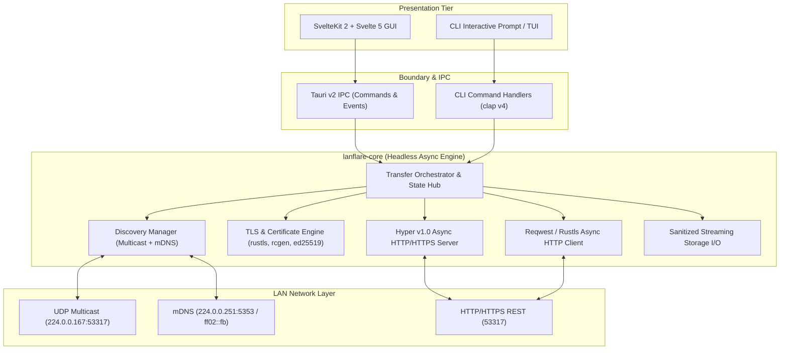
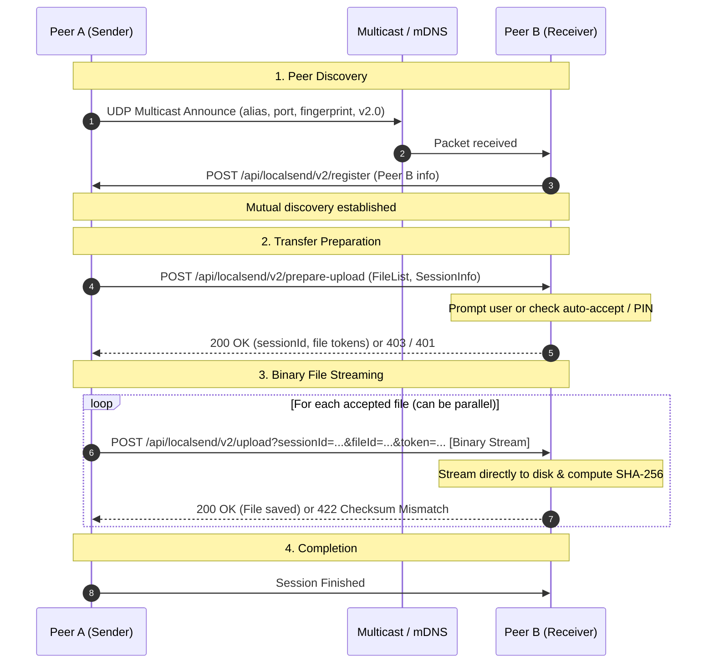
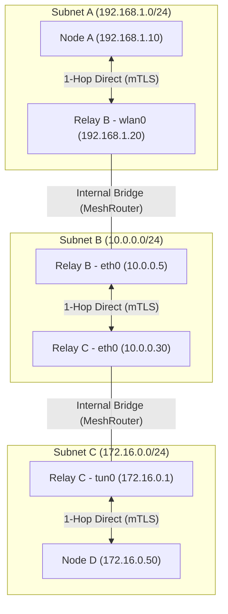
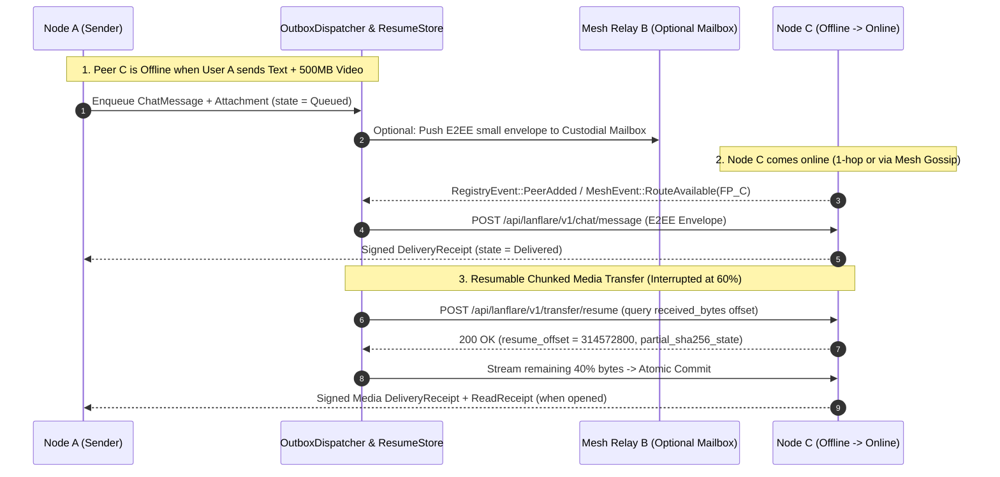

# Architecture Design: LanFlare

## 1. Overview & System Goals
**LanFlare** is a high-performance, memory-safe, cross-platform local network file sharing application written in **Rust**.
LanFlare has two primary runtime targets:
1. **Headless CLI (`lanflare`)**: Suitable for servers, terminals, automated environments, and scripting.
2. **Desktop GUI (`lanflare-desktop`)**: Cross-platform desktop interface powered by **Tauri v2** and **SvelteKit 2 / Svelte 5**.

LanFlare is designed with **dual-mode interoperability**:
- **LocalSend Compatible Mode**: Strict compliance with the official **LocalSend v2.2 REST + Multicast protocol**, enabling seamless bidirectional sharing with all existing LocalSend applications (Android, iOS, Windows, macOS, Linux).
- **LanFlare Native Mode**: Enhanced peer discovery using zero-configuration **mDNS (DNS-SD)**, optional streaming optimizations, and enhanced security primitives.

---

## 2. High-Level System Architecture



---

## 3. Core Invariants & Runtime Strategy

### 3.1 Async Runtime Strategy (Tokio)
- **Multi-threaded Runtime**: Standard Tokio multi-threaded runtime (`rt-multi-thread`) to efficiently balance concurrent network transfers, cryptographic hashing, and disk I/O.
- **Structured Task Lifecycles**: All long-lived tasks (multicast listener, mDNS daemon, HTTP listener, individual session transfers) are supervised using `tokio_util::sync::CancellationToken` and managed within `tokio::task::JoinSet` to prevent orphaned background tasks.
- **Non-blocking Disk I/O**: Heavy disk writes and checksum computations utilize `tokio::fs` alongside streaming chunks via `tokio::io::BufWriter` and `tokio_util::io::ReaderStream`. Blocking syscalls (such as filesystem canonicalization) run inside `tokio::task::spawn_blocking`.

### 3.2 Thread-Safety & Concurrency Model
- **Actor-inspired / Message Passing**: Inter-subsystem communication relies on bounded Tokio channels (`mpsc`, `broadcast`, `oneshot`).
- **Minimal Shared Mutable State**: Where state is shared (e.g., active transfer sessions, discovered device registry), it is protected via fine-grained asynchronous reader-writer locks (`tokio::sync::RwLock`) or atomic primitives (`AtomicBool`, `AtomicU64`), never blocking mutexes across `.await` points.
- **Zero-Deadlock Invariant**: Lock hierarchy is strictly acyclic: Registry locks are never acquired while holding a session transfer lock.

### 3.3 Security Invariants & Cryptography
- **Mutual TLS (mTLS)**: In HTTPS mode, self-signed RSA-2048 or Ed25519 certificates are generated at startup or persisted per user configuration. Each device's identity is defined by the SHA-256 fingerprint of its DER certificate.
- **Fingerprint Verification**: In incoming and outgoing transfers, certificates are inspected via `rustls` server and client verifiers. A transfer is rejected if the connection's peer certificate fingerprint differs from the announced fingerprint in the handshake metadata.
- **Strict Path Traversal Guard**:
  - File paths received from untrusted peers must be sanitized.
  - Slashes, null bytes, relative path components (`..`, `.`), and filesystem-reserved prefixes are stripped or rejected.
  - Files are written to temporary files (`.lanflare-part`) and atomically moved to the destination folder upon successful SHA-256 verification.
- **Explicit User Consent & PIN**:
  - Every incoming session must pass through an authorization gate (`PrepareUploadDecision`: Accept, Reject, or PinRequired).
  - PIN codes (`?pin=<pin>`) are validated using constant-time comparison.

### 3.4 Cross-Platform Considerations
- **Linux-First & POSIX Compatibility**:
  - Binding to `0.0.0.0` and proper socket option configuration (`SO_REUSEADDR` / `SO_REUSEPORT` via `socket2`).
  - Handling interface enumerations (`if-addrs`) across dynamic network status changes (e.g., Wi-Fi, Ethernet, VPN interfaces).
  - Clean path handling respecting `XDG_DOWNLOAD_DIR` / `~/.config/lanflare`.
- **Windows & macOS Portability**:
  - Windows socket error recovery (WSAECONNRESET / transient ICMP drops on UDP sockets).
  - macOS link-local multicast socket binding per interface index (`IP_MULTICAST_IF`).
  - Cross-platform configuration paths via standard platform directory resolvers (`dirs` crate).

---

## 4. Module Breakdown & Directory Structure

```text
lanflare/
├── ARCHITECTURE.md                 # System architecture specification
├── ROADMAP.md                      # Phased development roadmap & acceptance criteria
├── PROGRESS.md                     # Operational progress & ADR ledger
├── Cargo.toml                      # Workspace manifest
├── crates/
│   ├── lanflare-proto/             # Protocol DTOs, serialization, LocalSend v2.2 schemas
│   │   ├── Cargo.toml
│   │   └── src/
│   │       ├── lib.rs              # Protocol export root
│   │       ├── discovery.rs        # Multicast & register packet structures
│   │       ├── transfer.rs         # File metadata, session states, upload/download DTOs
│   │       └── error.rs            # Protocol-level errors
│   │
│   ├── lanflare-core/              # Core business logic & network execution engine
│   │   ├── Cargo.toml
│   │   └── src/
│   │       ├── lib.rs              # Core library entry point
│   │       ├── config.rs           # Runtime configuration & defaults
│   │       ├── crypto/             # TLS, certificate generator, fingerprinting
│   │       │   ├── mod.rs
│   │       │   ├── cert.rs
│   │       │   └── verifier.rs
│   │       ├── discovery/          # Discovery engines & aggregation
│   │       │   ├── mod.rs
│   │       │   ├── multicast.rs    # LocalSend UDP multicast (224.0.0.167)
│   │       │   ├── mdns.rs         # Modern DNS-SD discovery engine
│   │       │   ├── scanner.rs      # Subnet HTTP scan fallback
│   │       │   └── registry.rs     # Discovered peers store & deduplication
│   │       ├── server/             # Hyper v1 HTTP/HTTPS server
│   │       │   ├── mod.rs
│   │       │   ├── router.rs       # Endpoint router (/api/localsend/v2/*)
│   │       │   ├── handlers.rs     # Request handlers (register, prepare, upload, info)
│   │       │   └── session.rs      # Session tracking & concurrency throttling
│   │       ├── client/             # Reqwest HTTP/HTTPS client
│   │       │   ├── mod.rs
│   │       │   └── transfer.rs     # Sender orchestrator & streaming uploads
│   │       └── storage/            # Disk I/O, streaming verification & sandbox protection
│   │           ├── mod.rs
│   │           ├── path.rs         # Path sanitizer & traversal checks
│   │           └── writer.rs       # Streaming buffered writer with hashing
│   │
│   ├── lanflare-cli/               # Standalone command-line application
│   │   ├── Cargo.toml
│   │   └── src/
│   │       ├── main.rs             # CLI binary entry point
│   │       ├── commands/           # Subcommands: send, receive, scan, status
│   │       └── tui/                # Progress indicators & terminal output
│   │
│   └── lanflare-desktop/           # Tauri v2 Desktop entry crate
│       ├── Cargo.toml
│       └── src/
│           ├── main.rs             # Tauri application entry point
│           └── commands.rs         # Tauri IPC invoke commands
│
└── web/                            # Tauri GUI Frontend (SvelteKit 2 + Svelte 5)
    ├── package.json
    ├── svelte.config.js
    ├── vite.config.js
    └── src/
        ├── app.html
        ├── lib/                    # Shared Svelte components & runes state
        └── routes/                 # Application routes
```

---

## 5. Transport Boundaries & Protocol Handshake

### 5.1 LocalSend v2.2 Compatible Handshake Flow




---

## 6. Multi-Hop Overlay Mesh Network & Virtual Network Simulator Architecture

### 6.1 Architectural Motivation & Overlay Model
Standard LAN discovery (`UDP Multicast 224.0.0.167`, `mDNS 224.0.0.251`, and `/24` active subnet probing) is restricted to a single Layer-2 broadcast domain or `/24` IPv4 prefix. When a multi-homed device **Relay B** bridges two or more isolated networks (e.g., `wlan0` on `192.168.1.0/24` and `eth0`/`wg0` on `10.0.0.0/24`), peers in Network 1 (**Node A**) and peers in Network 2 (**Node C**) cannot directly discover or communicate with each other.

LanFlare introduces a decentralized **Multi-Hop Overlay Mesh Layer (`lanflare-core::mesh`)** mounted under `/api/lanflare/v1/mesh/*` while preserving 100% backward compatibility with `/api/localsend/v2/*`.



### 6.2 Path-Vector Gossip & Cryptographic Node Announcements
- **Signed Node Descriptors (`MeshNodeAnnouncement`)**:
  - Every mesh-capable node signs its identity card `(fingerprint, alias, cert_pem, capabilities, relay_enabled, seq_no, timestamp_ms)` using the private key of its persisted `TlsIdentity`.
  - Any node $N$ hops away verifies `fingerprint == SHA256(DER(cert_pem))` and verifies the cryptographic signature over `(seq_no, timestamp_ms, capabilities)`. Intermediate relays cannot forge or tamper with node announcements.
- **Loop-Free Path-Vector Gossip (`POST /api/lanflare/v1/mesh/gossip`)**:
  - Each node maintains a thread-safe `MeshTopologyGraph` storing known `MeshNode` descriptors and directed `MeshLink` edges `(src_fp, dst_fp, rtt_ms, subnet_tag, bandwidth_kbps, last_seen_ms)`.
  - Gossip route advertisements include `route_path: Vec<String>` (ordered list of traversed `fingerprint`s) and `ttl: u8` (default `MAX_MESH_TTL = 5`).
  - **Loop Prevention Invariant**: A node immediately drops any route advertisement whose `route_path` already contains its own `fingerprint`, or whose `seq_no` is older than the highest sequence number recorded for that origin `fingerprint`.
  - **Composite Route Metric**: Next-hop routing uses Dijkstra shortest-path selection over the composite link cost:
    $$\text{PathCost}(P) = \sum_{e \in P} \left( \text{HOP\_PENALTY\_MS} + e.\text{rtt\_ms} \right)$$

### 6.3 End-to-End Encryption (E2EE) & Cut-Through Stream Relaying
- **Zero-Trust Relay E2EE Envelope (`lanflare-core::crypto::e2ee`)**:
  - Intermediate relay nodes only inspect outer routing headers (`packet_id`, `src_fp`, `dst_fp`, `ttl`, `route_path`, `payload_len`).
  - Inner payloads (chat messages, receipts, file metadata, and binary file chunks) are encrypted end-to-end between `src_fp` and `dst_fp` using ephemeral X25519/HKDF-SHA256 key agreement (bound to both peers' X.509 public keys) and `CHACHA20_POLY1305` AEAD framing.
- **Cut-Through Multi-Hop File Streaming (`POST /api/lanflare/v1/mesh/stream`)**:
  - When Node A streams a multi-gigabyte file to Node D across `A -> B -> C -> D`, relays B and C do **not** buffer the entire file in memory or on disk.
  - Each relay opens an outbound Hyper/Reqwest streaming request to `next_hop(dst_fp)` and pipes 128 KB E2EE frames directly across the async stream with bounded Tokio backpressure (`max_concurrent_relays` semaphore and configurable token-bucket bandwidth cap).

### 6.4 Two-Tier Virtual Network Simulator (`lanflare-core::mesh::sim`)
To enable deterministic verification of multi-subnet mesh discovery, multi-hop routing, and link failure recovery on a single developer machine without physical routers:
1. **In-Process `VirtualNetworkMatrix` Interceptor**:
   - Spawns $N$ isolated LanFlare runtime instances in a single Tokio process bound to `127.0.0.1:<ephemeral_port_i>` (or UNIX domain sockets on Linux).
   - Enforces a virtual subnet adjacency matrix (`can_reach(node_a, node_b) -> Option<SimulatedLinkConfig>`) that filters discovery packets and direct HTTP connections between nodes not sharing a virtual subnet.
   - Supports programmable fault injection: artificial RTT latency, jitter, packet drop percentage, bandwidth throttling, and dynamic node/link churn.
2. **Interactive GUI & CLI Mesh Sandbox**:
   - Exposes a built-in sandbox mode (`lanflare mesh-sim` in CLI and the **"Virtual Mesh Sandbox"** toggle in `MeshTopologyView.svelte`) that spins up virtual multi-subnet nodes (`Home-WiFi`, `Office-LAN`, `Lab-VLAN`) so users can visually inspect multi-hop routes, sever virtual links, and test multi-hop chat and file transfers live.

---

## 7. Delay-Tolerant P2P Chat, Resumable Media & Decentralized Group Sync

### 7.1 Identity-First Addressing & Persistent Local Store (`lanflare-core::chat::store`)
- Unlike cloud messengers with a central server, LAN peers frequently go offline, sleep, or roam across subnets.
- All contacts, 1:1 conversations, group memberships, messages, and queued outgoing tasks are persisted locally under `<data_dir>/lanflare/chat/` and indexed strictly by canonical 64-character uppercase SHA-256 `fingerprint`.
- Even when a peer reconnects days later with a new DHCP IP address or 3 hops away via a mesh relay, its `fingerprint` uniquely binds it to its conversation history and pending outbox queue.

### 7.2 Delay-Tolerant Outbox (`OutboxDispatcher`) & Resumable Media Transfers


- **Resumable `.lanflare-part` Transfers (`lanflare-core::storage::resume`)**:
  - For trusted contacts, if an active file or video transfer is interrupted by a network drop, `StreamingFileWriter` persists a companion `.{filename}.{session_id}.lanflare-resume.json` checkpoint tracking `bytes_written` and incremental chunk hashes rather than unlinking the partial file immediately.
  - When the peer reappears online, `OutboxDispatcher` queries `/api/lanflare/v1/transfer/resume` and streams only the remaining byte range `[resume_offset..total_size]`.
- **Custodial Mesh Relay Mailbox (`lanflare-core::mesh::mailbox`)**:
  - When Sender A and Receiver C are never online simultaneously, Sender A can deposit compact E2EE message bundles into a mutually reachable relay node's `RelayMailbox` (`POST /api/lanflare/v1/mesh/mailbox`), subject to strict per-peer byte quotas and TTL expiration.

### 7.3 Decentralized Group Chat (`lanflare-core::chat::group`)
- **Causal Merkle-DAG & Hybrid Logical Clocks (HLC)**:
  - Each group is identified by a `group_id` (UUID), a signed `GroupMembershipRoster`, and a symmetric `GroupEpochKey` distributed via pairwise E2EE to each member's public key.
  - Every group message carries an HLC timestamp (`wall_time_ms`, `logical_counter`, `node_fp`) and references up to 4 parent message IDs (`parent_hashes: Vec<String>`), forming a serverless, tamper-evident Causal Merkle-DAG.
- **Anti-Entropy Frontier Gossip Sync (`POST /api/lanflare/v1/chat/group-sync`)**:
  - When an offline group member reconnects to the LAN or mesh, it exchanges its DAG frontier (`head_msg_ids`) with any online group peer and pulls missing DAG nodes and media attachments in causal topological order.

---

## 8. Zero-Trust LAN Anti-Harassment & Abuse Prevention (`lanflare-core::chat::trust`)

Because LAN environments (universities, offices, hotels, conferences) include untrusted strangers, LanFlare enforces a strict **5-Layer Anti-Abuse Gate**:

1. **3-Tier Contact Trust State Machine**:
   - `Stranger`: Unknown `fingerprint`. Cannot push files, images, voice notes, or videos. Permitted to send at most **one** plain-text introduction request ($\le 280$ UTF-8 characters, stripped of active links/media) which enters a muted **Message Requests** queue. All subsequent packets from that `fingerprint` receive `HTTP 403 Locked` until the local user explicitly accepts.
   - `TrustedContact`: Explicitly accepted peer (or paired via PIN / QR / "My Devices" ring). Permitted full rich-media chat, automatic byte-offset transfer resumption, delivery/read receipts, and group synchronization.
   - `Blocked`: Cryptographic `fingerprint` + IP/subnet blocklist. Packets are dropped silently at the router boundary with zero disk I/O or UI notifications.
2. **Anti-Sybil Hashcash Proof-of-Work (PoW)**:
   - To prevent a harasser from repeatedly calling `regenerate_identity` to rotate their `fingerprint` and bypass blocks, every initial `TrustRequestDto` from a `Stranger` must carry a valid **Hashcash PoW stamp**:
     $$\text{LeadingZeroBits}\left(\text{SHA256}(\text{sender\_fp} \parallel \text{target\_fp} \parallel \text{time\_bucket} \parallel \text{nonce})\right) \ge k$$
   - Verification is $O(1)$ (single SHA-256 hash), while generation costs ~1–2 seconds of CPU and is further throttled by a **Per-IP / Per-Subnet Token-Bucket Rate Limiter**.
3. **Zero Unsolicited Disk Allocation**:
   - No temporary `.lanflare-part` file or media attachment is ever allocated on disk for `Stranger` or `Blocked` peers.
4. **"Contacts Only" / Do-Not-Disturb Mode**:
   - Global toggle that immediately rejects all `Stranger` handshake requests and discovery probes when operating in untrusted public networks.

---

## 9. Multi-Functional LAN Toolbox Architecture (`lanflare-core::toolbox`)

1. **"My Devices" Self-Trust Ring & Universal Mesh Clipboard (`toolbox::clipboard`)**:
   - Devices paired with a one-time mutual PIN/QR form a personal `DeviceRing`. Clipboard changes (text, code snippets, screenshots, file URIs) are E2EE-broadcast across the user's own devices over 1-hop LAN or multi-hop mesh (`/api/lanflare/v1/toolbox/clipboard`).
2. **Federated Mesh File Search (`toolbox::search`)**:
   - Extends `DufsManager` by indexing shared folder metadata into a lightweight inverted trigram/filename index. Peers can query `/api/lanflare/v1/toolbox/search` across the mesh and stream matching files directly via `/dufs` or `/api/localsend/v2/download`.
3. **Collaborative CRDT Scratchpad (`toolbox::collab`) & Mesh Diagnostics (`mesh::diagnostics`)**:
   - Conflict-free replicated shared Markdown/code scratchpad using LWW-Element-Set / sequence CRDTs synced over group gossip, plus memory-to-memory multi-hop throughput benchmarking and traceroute diagnostics (`/api/lanflare/v1/mesh/benchmark`).

---

## 10. Extended Module Breakdown (Phases 7–11)

```text
lanflare/
├── crates/
│   ├── lanflare-proto/
│   │   └── src/
│   │       ├── lib.rs              # Exports discovery, transfer, mesh, chat, toolbox
│   │       ├── discovery.rs        # LocalSend v2.2 discovery DTOs
│   │       ├── transfer.rs         # LocalSend v2.2 transfer DTOs
│   │       ├── mesh.rs             # [NEW] Mesh gossip, routing, E2EE & simulator DTOs
│   │       ├── chat.rs             # [NEW] DTN chat, receipts, group DAG & trust PoW DTOs
│   │       ├── toolbox.rs          # [NEW] Clipboard ring, mesh file search & collab DTOs
│   │       └── error.rs            # Protocol-level errors
│   │
│   ├── lanflare-core/
│   │   └── src/
│   │       ├── lib.rs              # Exports config, crypto, discovery, server, client, storage, mesh, chat, toolbox
│   │       ├── crypto/
│   │       │   ├── mod.rs
│   │       │   ├── cert.rs         # X.509 RSA/Ed25519 identity & fingerprinting
│   │       │   ├── verifier.rs     # Pinned fingerprint mTLS verifiers
│   │       │   └── e2ee.rs         # [NEW] End-to-end encryption envelopes for multi-hop relays
│   │       ├── storage/
│   │       │   ├── mod.rs
│   │       │   ├── path.rs         # Traversal sanitizer
│   │       │   ├── writer.rs       # Streaming SHA-256 file writer
│   │       │   └── resume.rs       # [NEW] Byte-offset checkpointing & resumable stream store
│   │       ├── mesh/               # [NEW] Multi-hop overlay mesh subsystem
│   │       │   ├── mod.rs
│   │       │   ├── graph.rs        # Topology graph, path-vector loop guard & Dijkstra routing
│   │       │   ├── router.rs       # Gossip engine, E2EE packet forwarder & cut-through stream relay
│   │       │   ├── mailbox.rs      # Custodial store-and-forward relay mailbox with quotas
│   │       │   ├── diagnostics.rs  # Multi-hop ping, traceroute & memory-to-memory speedtest
│   │       │   └── sim.rs          # VirtualNetworkMatrix simulator & multi-subnet test harness
│   │       ├── chat/               # [NEW] Delay-tolerant P2P & group chat subsystem
│   │       │   ├── mod.rs
│   │       │   ├── trust.rs        # 3-tier trust gate, Hashcash PoW & IP/fingerprint rate limiter
│   │       │   ├── store.rs        # Persistent contact book, conversation & message store
│   │       │   ├── outbox.rs       # Reactive DTN outbox dispatcher & receipt state machine
│   │       │   ├── engine.rs       # 1:1 rich media chat orchestrator & endpoint handlers
│   │       │   ├── group.rs        # HLC clock, Causal Merkle-DAG & group key management
│   │       │   └── sync.rs         # Anti-entropy DAG frontier synchronization engine
│   │       └── toolbox/            # [NEW] Multi-functional LAN collaboration tools
│   │           ├── mod.rs
│   │           ├── clipboard.rs    # "My Devices" self-trust ring & E2EE clipboard sync
│   │           ├── search.rs       # Federated mesh file catalog & distributed Dufs search
│   │           └── collab.rs       # Real-time CRDT shared scratchpad & markdown canvas
```
