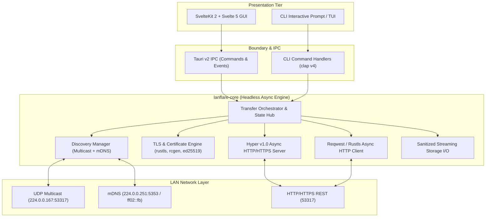
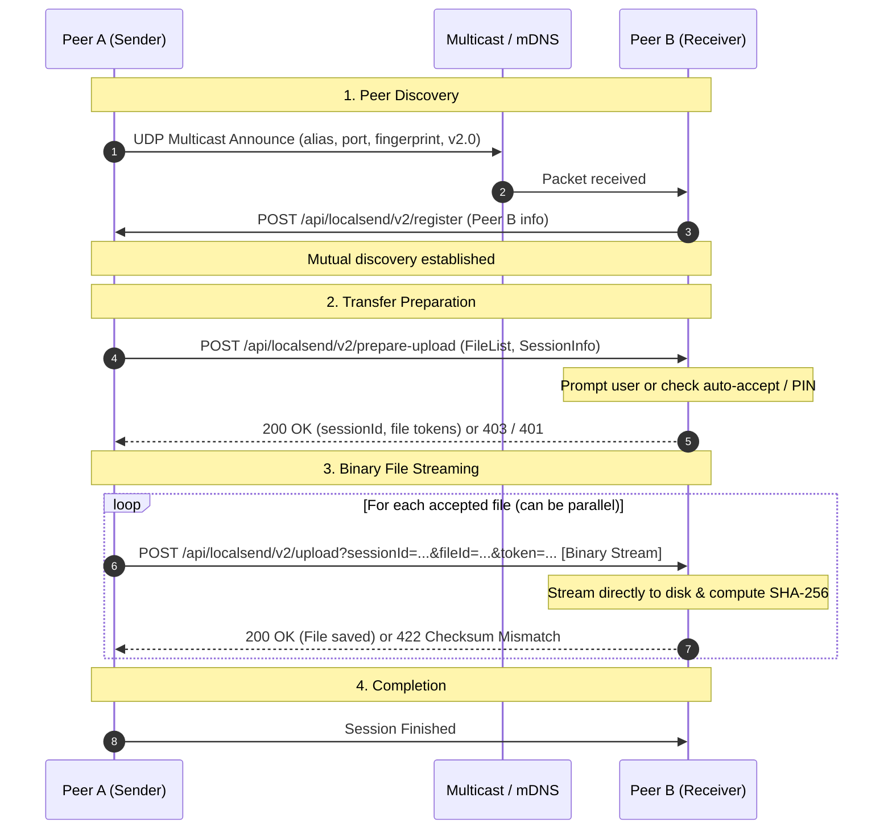

# Architecture Design: LanFlare

## 1. Overview & System Goals
**LanFlare** is a high-performance, memory-safe, cross-platform local network file sharing application written in **Rust**.
LanFlare has two primary runtime targets:
1. **Headless CLI (`lanflare`)**: Suitable for servers, terminals, automated environments, and scripting.
2. **Desktop GUI (`lanflare-desktop`)**: Cross-platform desktop interface powered by **Tauri v2** and **SvelteKit 2 / Svelte 5**.

LanFlare is designed with **dual-mode interoperability**:
- **LocalSend Compatible Mode**: Strict compliance with the official **LocalSend v2.2 REST + Multicast protocol**, enabling seamless bidirectional sharing with all existing LocalSend applications (Android, iOS, Windows, macOS, Linux).
- **LanFlare Native Mode**: Enhanced peer discovery using zero-configuration **mDNS (DNS-SD)**, optional streaming optimizations, and enhanced security primitives.

---

## 2. High-Level System Architecture



---

## 3. Core Invariants & Runtime Strategy

### 3.1 Async Runtime Strategy (Tokio)
- **Multi-threaded Runtime**: Standard Tokio multi-threaded runtime (`rt-multi-thread`) to efficiently balance concurrent network transfers, cryptographic hashing, and disk I/O.
- **Structured Task Lifecycles**: All long-lived tasks (multicast listener, mDNS daemon, HTTP listener, individual session transfers) are supervised using `tokio_util::sync::CancellationToken` and managed within `tokio::task::JoinSet` to prevent orphaned background tasks.
- **Non-blocking Disk I/O**: Heavy disk writes and checksum computations utilize `tokio::fs` alongside streaming chunks via `tokio::io::BufWriter` and `tokio_util::io::ReaderStream`. Blocking syscalls (such as filesystem canonicalization) run inside `tokio::task::spawn_blocking`.

### 3.2 Thread-Safety & Concurrency Model
- **Actor-inspired / Message Passing**: Inter-subsystem communication relies on bounded Tokio channels (`mpsc`, `broadcast`, `oneshot`).
- **Minimal Shared Mutable State**: Where state is shared (e.g., active transfer sessions, discovered device registry), it is protected via fine-grained asynchronous reader-writer locks (`tokio::sync::RwLock`) or atomic primitives (`AtomicBool`, `AtomicU64`), never blocking mutexes across `.await` points.
- **Zero-Deadlock Invariant**: Lock hierarchy is strictly acyclic: Registry locks are never acquired while holding a session transfer lock.

### 3.3 Security Invariants & Cryptography
- **Mutual TLS (mTLS)**: In HTTPS mode, self-signed RSA-2048 or Ed25519 certificates are generated at startup or persisted per user configuration. Each device's identity is defined by the SHA-256 fingerprint of its DER certificate.
- **Fingerprint Verification**: In incoming and outgoing transfers, certificates are inspected via `rustls` server and client verifiers. A transfer is rejected if the connection's peer certificate fingerprint differs from the announced fingerprint in the handshake metadata.
- **Strict Path Traversal Guard**:
  - File paths received from untrusted peers must be sanitized.
  - Slashes, null bytes, relative path components (`..`, `.`), and filesystem-reserved prefixes are stripped or rejected.
  - Files are written to temporary files (`.lanflare-part`) and atomically moved to the destination folder upon successful SHA-256 verification.
- **Explicit User Consent & PIN**:
  - Every incoming session must pass through an authorization gate (`PrepareUploadDecision`: Accept, Reject, or PinRequired).
  - PIN codes (`?pin=<pin>`) are validated using constant-time comparison.

### 3.4 Cross-Platform Considerations
- **Linux-First & POSIX Compatibility**:
  - Binding to `0.0.0.0` and proper socket option configuration (`SO_REUSEADDR` / `SO_REUSEPORT` via `socket2`).
  - Handling interface enumerations (`if-addrs`) across dynamic network status changes (e.g., Wi-Fi, Ethernet, VPN interfaces).
  - Clean path handling respecting `XDG_DOWNLOAD_DIR` / `~/.config/lanflare`.
- **Windows & macOS Portability**:
  - Windows socket error recovery (WSAECONNRESET / transient ICMP drops on UDP sockets).
  - macOS link-local multicast socket binding per interface index (`IP_MULTICAST_IF`).
  - Cross-platform configuration paths via standard platform directory resolvers (`dirs` crate).

---

## 4. Module Breakdown & Directory Structure

```text
lanflare/
├── ARCHITECTURE.md                 # System architecture specification
├── ROADMAP.md                      # Phased development roadmap & acceptance criteria
├── PROGRESS.md                     # Operational progress & ADR ledger
├── Cargo.toml                      # Workspace manifest
├── crates/
│   ├── lanflare-proto/             # Protocol DTOs, serialization, LocalSend v2.2 schemas
│   │   ├── Cargo.toml
│   │   └── src/
│   │       ├── lib.rs              # Protocol export root
│   │       ├── discovery.rs        # Multicast & register packet structures
│   │       ├── transfer.rs         # File metadata, session states, upload/download DTOs
│   │       └── error.rs            # Protocol-level errors
│   │
│   ├── lanflare-core/              # Core business logic & network execution engine
│   │   ├── Cargo.toml
│   │   └── src/
│   │       ├── lib.rs              # Core library entry point
│   │       ├── config.rs           # Runtime configuration & defaults
│   │       ├── crypto/             # TLS, certificate generator, fingerprinting
│   │       │   ├── mod.rs
│   │       │   ├── cert.rs
│   │       │   └── verifier.rs
│   │       ├── discovery/          # Discovery engines & aggregation
│   │       │   ├── mod.rs
│   │       │   ├── multicast.rs    # LocalSend UDP multicast (224.0.0.167)
│   │       │   ├── mdns.rs         # Modern DNS-SD discovery engine
│   │       │   ├── scanner.rs      # Subnet HTTP scan fallback
│   │       │   └── registry.rs     # Discovered peers store & deduplication
│   │       ├── server/             # Hyper v1 HTTP/HTTPS server
│   │       │   ├── mod.rs
│   │       │   ├── router.rs       # Endpoint router (/api/localsend/v2/*)
│   │       │   ├── handlers.rs     # Request handlers (register, prepare, upload, info)
│   │       │   └── session.rs      # Session tracking & concurrency throttling
│   │       ├── client/             # Reqwest HTTP/HTTPS client
│   │       │   ├── mod.rs
│   │       │   └── transfer.rs     # Sender orchestrator & streaming uploads
│   │       └── storage/            # Disk I/O, streaming verification & sandbox protection
│   │           ├── mod.rs
│   │           ├── path.rs         # Path sanitizer & traversal checks
│   │           └── writer.rs       # Streaming buffered writer with hashing
│   │
│   ├── lanflare-cli/               # Standalone command-line application
│   │   ├── Cargo.toml
│   │   └── src/
│   │       ├── main.rs             # CLI binary entry point
│   │       ├── commands/           # Subcommands: send, receive, scan, status
│   │       └── tui/                # Progress indicators & terminal output
│   │
│   └── lanflare-desktop/           # Tauri v2 Desktop entry crate
│       ├── Cargo.toml
│       └── src/
│           ├── main.rs             # Tauri application entry point
│           └── commands.rs         # Tauri IPC invoke commands
│
└── web/                            # Tauri GUI Frontend (SvelteKit 2 + Svelte 5)
    ├── package.json
    ├── svelte.config.js
    ├── vite.config.js
    └── src/
        ├── app.html
        ├── lib/                    # Shared Svelte components & runes state
        └── routes/                 # Application routes
```

---

## 5. Transport Boundaries & Protocol Handshake

### 5.1 LocalSend v2.2 Compatible Handshake Flow


